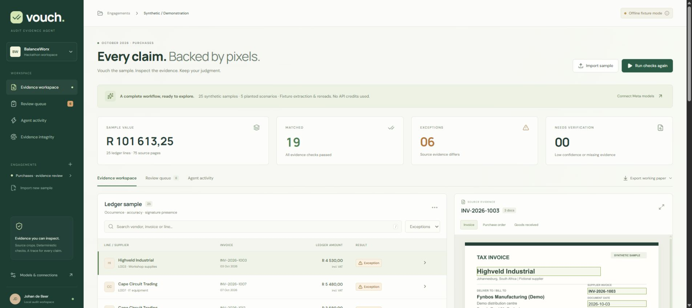

# Vouch · Audit Evidence Agent

[Public source repository](https://github.com/Johan-de-Beer/vouch-audit-evidence-agent) · [Automated checks](https://github.com/Johan-de-Beer/vouch-audit-evidence-agent/actions) · [Validation record](docs/VALIDATION.md)



Vouch reviews a purchases ledger sample against invoices, purchase orders and goods received notes. It connects each supported finding to a crop of the source evidence, records the agent's work, and produces a working paper for an auditor to review.

**The complete synthetic demonstration runs without API credits.** Its extracted values, crop coordinates and simulated rereads come from labelled fixtures. Live Meta and Baseten adapters are implemented separately and have **not yet been validated with credentials**. A model name or a “Configured” badge means configuration is present, not that inference succeeded.

Built with Codex on **29 October 2026** for the Meta Global AI Developer Hackathon. Muse Code was not used in this build. The researched plan is recorded in [research/PLAN.md](research/PLAN.md), with corrections to dates and attribution.

## Run locally

Use **Node.js 24** and npm. The server uses Node's built-in SQLite support and native image packages. Run from this directory:

```powershell
npm ci
Copy-Item .env.example .env
npm run seed
npm run dev
```

If `.env` already exists, keep it instead of copying over it. Open **http://127.0.0.1:5173**. The development command starts both the API on port 3001 and Vite on port 5173. API/file requests pass through Vite's proxy. Demo generation is also automatic on first use, so `seed` is optional.

For the production build, serve the frontend and API from the same process:

```powershell
npm run build
npm start
```

Open **http://127.0.0.1:3001**. On Windows, `./start.ps1` installs missing dependencies, creates `.env` only if absent, builds, and starts production. `./start.ps1 -Development` starts the development servers instead. Stop with Ctrl+C.

For a hidden background application, use `./start.ps1 -Background`. Stop that managed process with `./stop.ps1`. After adding keys to `.env`, stop and start the application so the server reloads them. Both scripts verify the recorded process belongs to this checkout before managing it.

## Try the demonstration

1. Select **Run evidence checks** on the automatically created synthetic engagement.
2. Filter the ledger to **Exceptions**, select a sample, and inspect its evidence cards and document overlays.
3. Open **Review queue**. Record a human conclusion with a reviewer name and rationale.
4. Add a typed auditor note to a selected sample. It is retained with the engagement.
5. Inspect **Agent activity** and run **Evidence integrity → Verify integrity**.
6. Use **Export working paper** to download the PDF, embedded-image HTML, structured JSON, JSONL event trail, or ZIP evidence bundle.

The ZIP contains working papers, original source files, evidence crops, structured engagement data and the event trail. The PDF includes all supporting claim crops. Live segmentation masks and their manifest are retained with the evidence bundle when present. Hash checks detect differences against retained hashes; they do not prove a source document is authentic or establish an audit opinion.

The fixture has **25 ledger rows, 75 source documents and nine controls per row: 225 control results**. Five planted scenarios affect six rows:

| Rows | Planted scenario |
| --- | --- |
| L003 | Ledger total 4,530.00; source invoice 4,350.00 |
| L007 | VAT 680.00 on net 4,800.00; fixture policy expects 720.00 |
| L012 | Ten units invoiced/ordered; eight received |
| L017 | Invoice authorisation signature absent |
| L021 and L022 | The same supplier invoice posted twice |

The latest retained [evaluation](docs/validation/evaluation.json) passed 225/225 fixture assertions and found all five scenarios across six rows, producing seven exception findings. The VAT scenario also fails the invoice/PO gross-total comparison. There were no false positives in this fixture. **These are deterministic pipeline checks, not model accuracy, benchmark generalisation, or a measured productivity improvement.** Regenerate with `npm run eval`. See [dataset details](docs/DATASET.md).

## Enable live models

Set server-side environment values in `.env`, then restart:

```dotenv
MODEL_API_KEY=<your Meta Model API key>
BASETEN_API_KEY=<your Baseten key>
```

Both keys are required for a live evidence run. Meta powers planning/extraction and SAM segmentation; Baseten provides a separate crop-only reread. Voice transcription requires the Meta key and can be tested separately. Keep keys out of browser code, screenshots, exported data and Git.

On Windows, `./configure.ps1` prompts for both keys with hidden input and preserves other `.env` settings. Use `./configure.ps1 -Provider Meta` for Meta only, or leave a prompt blank to keep its current value. Meta may require the account's billing setup before enabling key creation; receiving credits alone does not establish API access.

Run `npm run live:preflight -- --meta-only` for a bounded first Meta/SAM check. It creates a new fictional invoice and makes one extraction and one segmentation call, without changing an engagement or reading fixture answers. Once Baseten is configured, `npm run live:preflight` also independently rereads the total crop. Inspect the report under `artifacts/live-preflight/`; a failure, missing mask or uncertain result is not a successful live validation. These commands make real requests and may consume provider credits.

Use `npm run samples:live` to generate six small import packs under `artifacts/live-samples/`: a clean row and each planted scenario, including the paired duplicate rows. Each pack separates upload inputs from expected outcomes and source hashes. Start with the clean pack before attempting the full dataset.

| Environment variable | Default / purpose |
| --- | --- |
| `META_BASE_URL` | `https://api.meta.ai/v1` |
| `SPARK_MODEL` | `muse-spark-1.3` — planning and field extraction |
| `SAM_MODEL` | `sam-3.1` — streamed region masks and bounds |
| `BASETEN_BASE_URL` | `https://inference.baseten.co/v1` |
| `VERIFIER_MODEL` | `meta-models/muse-spark-open-1026` — event-guide Baseten model for blind crop reread; confirm account availability |
| `VOICE_MODEL` | `muse-voice-transcribe-1.0` — WAV transcription |
| `CONFIDENCE_THRESHOLD` | `0.8` — review threshold; an engineering setting, not calibrated probability |
| `VAT_RATE` | `0.15` — fixture arithmetic policy; configure the applicable rate explicitly for other samples |
| `DATA_DIR` | `./data` — persistent SQLite and evidence files |
| `HOST` / `PORT` | `127.0.0.1` / `3001` |
| `APP_TOKEN` | Optional on loopback; at least 24 characters required for network hosting |

Open **Models & connections** and select **Live Meta + Baseten API**, then run a small synthetic sample first. Follow [LIVE_VALIDATION.md](docs/LIVE_VALIDATION.md). Invalid keys, unavailable models and uncertain evidence must surface as failures/unverified findings. Live mode does not fall back to fixture answers. The authenticated event guide specifies the `-1026` Baseten slug above; use it in preference to the general cookbook identifier.

## Import a sample

Use **Import sample** or the downloadable ledger template. CSV columns `date`, `vendor`, `invoice_no`, `amount`, and `vat` are required. Optional columns include `id`, `account`, `currency`, `quantity`, `po_no`, and `assertion`. Dates use `YYYY-MM-DD`; amount/VAT values are non-negative. The importer accepts 1–500 ledger rows, up to 80 supporting files, 20 MB per file, and PDF/PNG/JPEG/WebP sources. PDFs are limited to 20 pages each and the engagement to 200 rendered pages.

Document roles are inferred from names: `PO`/`purchase order`, `GRN`/`delivery`/`received`, and `bank`/`statement`; otherwise a source is treated as an invoice. References must associate documents unambiguously. Imported samples require live credentials to analyse; offline fixtures apply only to the built-in synthetic demo. Use synthetic material for this hackathon. Source images and crops are sent to configured providers only when live tools are invoked.

The current price test uses one aggregate quantity/unit price per document, verifies quantity extensions against net totals, and compares invoice/PO net and gross totals. Multiple line items, discounts, freight, partial invoices and mixed tax rates need an expanded schema or explicit auditor reconciliation; the prototype does not infer adjustments to make a document match. The synthetic pack uses a fixed 15% VAT policy.

Voice notes accept **mono 16-bit PCM WAV at 16 or 24 kHz**, up to ten minutes and within the upload limit. Typed notes work offline. The application is a sample-vouching prototype: stock counts, bank matching, completeness testing, real-time voice, multi-tenant permissions and an audit-opinion engine are outside this build.

## Architecture and checks

React/Vite provides the ledger, source viewer, crop inspection, review queue and agent trace. Express coordinates ingestion and tools. SQLite stores engagement snapshots; files remain under `DATA_DIR`. A restart marks interrupted runs failed so they can be rerun. This is a single-server workspace with a shared access token, not per-user authorization.

Live flow: validated plan → pixel extraction → SAM crop refinement → integer-cent arithmetic and three-way matching → independent crop reread → bounded retry or human escalation → working paper. Source/crop hashes and chained events accompany the results. The independent reader receives the crop and requested field name, without the ledger answer. Provider output is structurally validated; absent evidence, disagreement or low confidence remains unverified. Live calls retain bounded execution metadata in the hash-chained trail: requested/returned model, request/response references, duration, status and token usage when supplied. This records SDK invocations, which may retry internally; it is not a complete billing ledger.

```powershell
npm test
npm run build
npm run eval
# Or run all three:
npm run check
```

These commands cover arithmetic, matching, input handling, evidence requirements, retries/abstention, hashes and fixture expectations. They do not require API keys and do not establish live provider compatibility. `artifacts/evaluation.json` records the reproducible fixture result; elapsed time is local pipeline runtime only.

## Container and hosting

A Dockerfile builds a Node 24 application and retains `tsx` for server execution. Supply a persistent volume and a random access token:

```powershell
docker build -t vouch .
$env:APP_TOKEN = [Convert]::ToHexString([System.Security.Cryptography.RandomNumberGenerator]::GetBytes(32))
docker run --rm -p 127.0.0.1:3001:3001 --env APP_TOKEN --mount source=vouch-data,target=/app/data vouch
```

Keep the token in your session and enter it in Vouch's unlock screen. The container defaults to `HOST=0.0.0.0`, `PORT=3001`, `DATA_DIR=/app/data`; it refuses to start without the token. Add provider keys as runtime secrets when ready. `.dockerignore` excludes `.env`, local evidence, generated artifacts and `node_modules` from the image context. The image runs as the `node` user; bind-mounted directories must be writable by that user.

The production image was built and exercised successfully in [GitHub Actions](https://github.com/Johan-de-Beer/vouch-audit-evidence-agent/actions/runs/40907509253). The test verified token authentication, session cookies, protected evidence files and a complete synthetic run with valid file hashes and result seal. Local Docker Desktop was not running; container validation ran on a fresh Linux CI host.

For a service such as Render or Fly, deploy this Dockerfile as **one persistent container**, expose port 3001 behind HTTPS, set `HOST=0.0.0.0` and `DATA_DIR=/app/data`, mount persistent storage there, and provide `APP_TOKEN` and provider keys using the host's secrets interface. Use `/api/health` for the health probe. Keep one replica: SQLite and source files are local. Do not use an ephemeral filesystem or static-only hosting for this API. This repository includes deployment preparation; **no hosted deployment has been performed**.

Back up the entire `DATA_DIR` while stopped, or use a SQLite-aware backup plus corresponding files; retain a trusted event/hash copy separately. Storage encryption, managed backups, SSO, tenant separation, retention controls, rate/budget governance and production operational review remain future work.

## Hackathon handoff

- [Verified rules and outstanding participant checks](docs/HACKATHON_RULES.md)
- [Required three-minute demo script and local rehearsal workflow](docs/DEMO_SCRIPT.md)
- [Submission draft with honest placeholders](docs/SUBMISSION_DRAFT.md)
- [Live validation and recording template](docs/LIVE_VALIDATION.md)

The authenticated [participant guide](https://cerebralvalley.ai/e/meta-ai-developer-hackathon/details) and submission form were inspected on 29 October without writes. The verified build window is **27 October–4 November 2026**. A **public GitHub repository** and **three-minute video** are required; the video must clearly show only functionality built during the hackathon. Basic RAG/simple-image-analyzer entries are excluded. Actual Meta API or Meta open-weight use is a **Stage 1 pass/fail requirement**, so the offline demo alone is not submission-ready.

The deadline is **5 November 2026, 04:00 SAST**. The public source repository is published. Live validation, public application hosting, the recorded/uploaded video, final personal declarations and submission remain pending. The guide's individual credit-claim form is processed in batches; applying credits requires a card with possible temporary preauthorization, and a spend-limit notification is not a guaranteed hard cap. No submission, social post, legal acceptance, billing change or credit claim is represented as completed.
